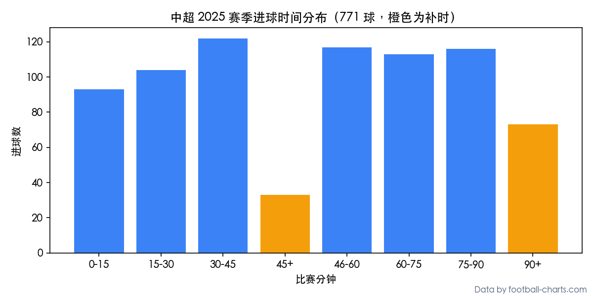

# 开放足球比赛数据集与免费 API（98 个联赛 / 中超 / 半场比分 / 进球分钟数）

[](https://creativecommons.org/licenses/by/4.0/)
[](https://doi.org/10.5281/zenodo.23348754)

本仓库汇集 **[Football Charts](https://www.football-charts.com/zh-cn/dataset?ref=github)** 面向中文开发者、数据分析师与高校学生的开放足球数据资源（适合 **Python 数据分析课程设计**、**数学建模竞赛 CUMCM/MCM** 与体育统计研究）：

- **中文开放数据集主页（92 个联赛补时进球占比排名 + 完整 CSV 镜像下载）：**  
  👉 **[https://www.football-charts.com/zh-cn/dataset](https://www.football-charts.com/zh-cn/dataset?ref=github)**
- **中文免费 API 文档（98 个联赛 JSON 接口，免注册直接调用）：**  
  👉 **[https://www.football-charts.com/zh-cn/developers](https://www.football-charts.com/zh-cn/developers?ref=github)**
- **完整历史赛季 API 与高校学术免费申请（中文）：**  
  👉 **[https://www.football-charts.com/zh-cn/pricing](https://www.football-charts.com/zh-cn/pricing?ref=github)**

---

## 仓库文件说明

| 文件 | 内容说明 |
|---|---|
| [`leagues_zh_cn.csv`](leagues_zh_cn.csv) | **全部 98 个联赛代码与中英文名称对照表**（含 `league` 接口代码、中文简称、国家、赛制写法 `2025-2026` vs `2025`） |
| [`stoppage_time_by_league_v2026.10.csv`](stoppage_time_by_league_v2026.10.csv) | **92 个联赛补时进球（90+ 分钟）与上半场补时（45+）占比统计表**（共 26,646 场比赛、72,568 个进球） |
| [`csl_2025_results.csv`](csl_2025_results.csv) | **中超（Chinese Super League）2025 赛季完整 240 场比赛赛果、半场比分与每个进球分钟数 CSV 样例** |
| [`fc_stoppage_time_zh.ipynb`](fc_stoppage_time_zh.ipynb) | **Jupyter 笔记本**：从原始开放数据集 CSV 复现 92 个联赛补时进球占比排名 |
| [`fc_api_quickstart_zh.py`](fc_api_quickstart_zh.py) | **Python 快速上手脚本**：免密钥调用 REST API 获取中超 2025 赛果与每 15 分钟进球分布，并用 `matplotlib` 自动匹配中文字体绘图 |
| **完整 76,991 场比赛 CSV（1.3 MB ZIP）** | **[从中文镜像直接下载 (`football_charts_matches_v2026.10.zip`)](https://www.football-charts.com/zh-cn/files/football_charts_matches_v2026.10.zip)**（与 Zenodo DOI `10.5281/zenodo.23348754` 字节级一致，国内网络可直接下载） |

---

## 核心发现：哪些足球联赛的补时绝杀（90+ 分钟进球）占比最高？

基于开放数据集中 **92 个联赛、72,568 个进球** 的精确进球分钟数统计：

1. **韩K2联（`korea2`）排名第 1**：**12.0%** 的进球发生在第 90 分钟之后（平均每 8 个进球就有 1 个在下半场补时）。
2. **中超（`china`）排名第 12**：2025 赛季 771 个进球中有 73 个发生在 90 分钟之后（占比 **9.5%**）。
3. **亚洲联赛普遍靠前**：排名前 12 的联赛中有 7 个来自亚洲（韩K2联、韩K联、印超、泰超、科威特超、日职乙、中超）。
4. **五大联赛对比**：英超 8.6%（第 22 位）、德甲 7.7%（第 38 位）、西甲 7.6%（第 42 位）、意甲 6.9%（第 58 位）、法甲 6.9%（第 59 位）。



完整交互式图表与方法说明请见：**[https://www.football-charts.com/zh-cn/dataset](https://www.football-charts.com/zh-cn/dataset?ref=github)**

---

## 30 秒用 Python 免密钥调用免费 API

无需注册、无需 API Key（匿名每天可调用 300 次；在 **[中文开发者页面](https://www.football-charts.com/zh-cn/developers?ref=github)** 用邮箱注册免费密钥后每天 **5,000 次**）：

```python
import requests

API = "https://footballcharts-backend.onrender.com/api/v1"

# 1. 获取中超 2025 赛季全部 240 场比赛赛果、半场比分与首球分钟数
res = requests.get(f"{API}/leagues/china/results/", params={"season": "2025"}, timeout=30).json()
print("中超 2025 场次:", res["count"])
for m in res["matches"][:3]:
    print(m["kickoff_utc"], m["homeTeam"], m["score"], m["awayTeam"], "半场:", m["ht_result"], "首球:", m["first_goal_time"])

# 2. 获取每 15 分钟进球分布（含 45+ 与 90+ 补时）
gt = requests.get(f"{API}/leagues/china/goal-timing/", params={"season": "2025"}, timeout=30).json()
print("每15分钟进球数:", dict(zip(gt["time_bins"], gt["stats"]["period_totals"])))
```

---

## 引用方式（GB/T 7714 与 BibTeX）

开放数据集采用 **CC BY 4.0** 许可协议，课程设计、学术论文与开源项目均可自由使用（请注明 `"Data by football-charts.com"`）：

```text
Football Charts. Football Match Results and Goal Timing, 92 Leagues (2023–2026): version 2026.10[DS/OL]. Zenodo, 2026. DOI: 10.5281/zenodo.23348754.
```
